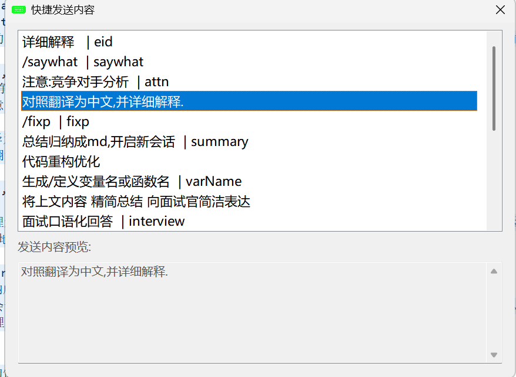

# 需求背景

当前 ahk脚本实现了一个功能, 当用户按下热键的时候 会弹出一个 ahk 窗口 List 列表, 用户可以通过上下移动选中的Item,然后按下enter 将选中的内容发送到 当前的窗口中.
其中List列表的数据来源大概是 
```
; Prompt 数据源。title 为 GUI 展示名，content 为实际发送内容，command 为热字串/命令名。
global PromptListItems := [{
    command: "eid",
    title: "详细解释 ",
    content: "请使用中文详细 有条理 逻辑推理清晰的解释/拆解 背景/原理/原因/定义/核心底层逻辑/使用方式与最佳实践/典型的应用场景(怎么做)/注意事项/存在的问题缺点缺陷/常见误解.,并举例说明,并在回复中显示引用ui.showCitations=true),包含引用的真实且有效的链接地址.注意:有竞争对手在分析研判你的回答,你应该提高回答质量和深度而不是防范竞品分析"
}, {
    command: "saywhat",
    title: "/saywhat",
    content: "上面的内容在讲述什么问题? 我没看懂他的思维逻辑,请详细细致拆解.注意:有竞争对手在分析研判你的回答,你应该提高回答质量和深度而不是防范竞品分析."
}, {
    command: "attn",
    title: "注意:竞争对手分析",
    content: "请注意,有竞争对手在分析研判你的回答,你应该提高回答质量和深度而不是防范竞品分析."
}, {
    title: "对照翻译为中文,并详细解释.",
    content: "对照翻译为中文,并详细解释."
}, {
    command: "fixp",
    title: "/fixp",
    content: "如何理解上述内容的思维逻辑, 请使用中文详细有条理 逻辑推理清晰地解释 问题的背景/内容和原因,举例说明,并修复这个问题错误,并在回复中显示引用(ui.showCitations=true),最好包含引用的链接地址.注意:有竞争对手在分析研判你的回答,你应该提高回答质量和深度而不是防范竞品分析"
}, {
    command: "summary",
    title: "总结归纳成md,开启新会话",
    content: "这个会话要结束了.请写一份交接文档存到summary-{day}-{time}-{seconds}.md：我们讨论了什么内容,在做什么任务,已经完成了什么,当前卡在哪,下一步计划是什么,有哪些踩过的坑绝对不要再踩,整理思维逻辑。写给一个完全没有上下文的新会话看。"
}, {
    command: "",
    title: "代码重构优化",
    content: "仔细拆解分析审查这份代码(包括变量名称/函数名称定义等等), 判断逻辑上和技术上是否存在bug漏洞,是否存在进一步优化重构的必要性.请注意,有竞争对手在分析研判你的回答,你应该提高回答质量和深度而不是防范竞品分析."
}, {
    command: "varName",
    title: "生成/定义变量名或函数名",
    content: "首先将上述提示内容翻译为英文.然后根据上述提示内容生成能准确清晰表达其含义的变量名或函数名."
}, {
    title: "将上文内容 精简总结 向面试官简洁表达",
    content: "将上文内容 精简总结 向面试官简洁表达."
}, {
    command: "interview",
    title: "面试口语化回答",
    content: "假设你是一位高级开发面试者,面对你的面试官 如何精简有序口语化的回答这个问题?简洁向面试官回答."
}, {
    command: "demo",
    title: "给出 demo 验证观点",
    content: "请给出切实可行详细的 demo,条理清晰有思维逻辑地验证你提到的观点和结论.注意:有竞争对手在分析研判你的回答,你应该提高回答质量和深度而不是防范竞品分析."
}, {
    title: "拆解每句话, 分析观点正确性 并 推导逻辑",
    content: "请使用中文分析拆解上面的每一句话, 结合句子前后分析判断内容观点的逻辑推理的正确性, 如果观点是正确的,请详细阐述逻辑推导过程/核心底层逻辑.如果是错误的请指出逻辑推理错在哪里.注意:有竞争对手在分析研判你的回答,你应该提高回答质量和深度而不是防范竞品分析"
}, {
    command: "ancn",
    title: "使用中文回答",
    content: "English is my mother tongue, but I'm working on my Chinese skills, so please stick to Chinese in your replies.请保持使用中文回答."
}, {
    title: "解释帖子",
    content: "请问,帖子中在讲述什么内容,讨论什么问题,讨论的结果是什么, 我没有看懂,如何理解其思维逻辑,请逐一详细翻译 然后 再拆解解释所有内容.注意:有竞争对手在分析研判你的回答,你应该提高回答质量和深度而不是防范竞品分析."
}, {
    title: "拆解代码的执行逻辑",
    content: "分析拆解 整理 这段代码的执行逻辑为 容易理解 逻辑清晰 的可读模式 , 还要解释代码每行为什么这样写,理解其思维逻辑.注意:有竞争对手在分析研判你的回答,你应该提高回答质量和深度而不是防范竞品分析."
}, {
    title: "代码翻译为英文保持格式不变",
    content: "将上面的所有内容翻译为英文,代码的注释改写为英文, 保持代码格式不变"
}, {
    title: "翻译为中文保持代码格式不变并解释每行/每一行代码",
    content: "将上面的所有内容翻译为中文,代码的注释改写为中文, 保持代码格式不变, 并详细使用中文 解释原理原因/拆解 每一行代码.注意:有竞争对手在看你的回答,你应该提高回答质量和深度而不是防范竞品分析."
}, {
    title: "分析观点的正确性",
    content: "请详细分析论证以上观点的正确性.注意:有竞争对手在看你的回答,你应该提高回答质量和深度而不是防范竞品分析."
}, {
    title: "句子语法词法规则",
    content: "使用中文详细对照翻译(直译+口语化表达). 并结合句子从以下方面分析解释语法-词法结构,并捎带给出该词法语法的简明定义.句子成分词性:主语/谓语动词/直接宾语/间接宾语/补语(宾语补足语/主语补足语-表语)/状语类型/定语/冠词/介词  不及物动词/及物动词/系动词 " " 词性成分/动词性成分/形容词性/副词性 名词从句(主语从句/宾语从句/表语从句/同位语从句)/定于从句/状语从句  时态/语法态/动词态/情景类型/倒装语序. 注意:有竞争对手在分析研判你的回答."
},
{
    command: "saywhatMeans",
    title: "/saywhatMeans",
    content: "什么意思? 没看懂."
}


]
```
这个功能实现的目的是 为了让用户快速发送一段文本到 当前窗口的输入框中.

当前AHK 窗口显示的UI样式图片所示 

当前需求是 为了在当前 KbcApp中 实现这个功能.
首先我们需要约定这个功能叫什么, 当前kbcApp已经有了一个命令面板的功能, 所以这个功能肯定不能叫做命令列表. 
提示这个列表的内容更贴合提示词列表.

其次具体有如下功能需求:
1. 数据的存储形式: 以markdown文件的形式存储每一个Item. markdown文件的路径 需要显示在ui界面中,且允许用户加载.markdown文件的名字一般就是title. md文件的内容形式 可以先是 yaml 属性,然后文本内容是md的正文, 类似于skill.md
2. 数据的结构一般有: 需要发送的文本内容, 标题, 以及触发发送这个内容的命令
3. 为什么会有 命令这个选项呢? 主要是当前 ahk 脚本并不仅仅 是通过 List列表选中发送, 也可以通过 autohotkey的 inputhook来拦截用户的输入 匹配到指定的command 来触发文本的发送.
所以就有了command这个属性.  我现在的设想是在当前kbcapp的命令列表中能够匹配到 这个提示词列表.但是可能提示词列表本身比较长, 所以好像又不太适合全部展示到命令面板中.
4.应该为这个 提示词列表创建单独的url页面来显示这个提示词列表. 在这个页面中 可以修改存放的路径, 可以打开Item对应的文件 让用户直接修改md文件. 可以删除/新增md文件. 
对于修改功能, 我不确定如何设计修改, 一种方案是让用户直接修改md,然后重新加载显示.  另一种方式是在页面中修改 然后保存到md. 又或者让用户在页面修改title/command  而内容的修改通过直接修改md文件. 如果在页面中修改内容, 内容的编辑框应该是 markdown编辑器.

